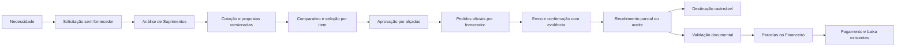

# Compras e Suprimentos — entrega do PRP

## Situação

Implementação no código com ativação controlada. Migração e testes executados exclusivamente em gridone_e2e, API 3100 e interface 3101. A base operacional gridone_db e os servidores 3000/3001 não receberam esta versão.

O envio ao GitHub foi autorizado pelo usuário. A migração e publicação operacionais dependem de autorização específica, conforme a seção 20 do PRP.

## Processo implementado

### Funcionalidades

- Solicitações com itens do catálogo ou descritivos, prioridade, prazo, justificativa, anexos e revisão.
- Vínculos por alocação: cliente, O.S., equipamento/série, contrato, venda, garantia, centro de custo e almoxarifado. Validação da consistência dos relacionamentos no servidor.
- Análise com saldo físico, reservado, disponível, mínimo, entradas pendentes e necessidades semelhantes. Entradas sem destino conhecido aparecem separadas. A lista de possíveis duplicidades respeita o escopo do solicitante.
- Consolidação de necessidades compatíveis, preservando cada origem e quantidade. Quantidades fracionadas e atendimento em pedidos separados.
- Convites com resposta, recusa, ausência e remoção; rodadas, versões comerciais, anexos privados e condições negociadas.
- Comparativo por item, custo, prazo, impostos, desconto, frete, garantia, validade, disponibilidade e compatibilidade. Avaliações existentes do fornecedor aparecem quando cadastradas.
- Escolha justificada por item. Versões antigas, propostas vencidas ou fornecedores retirados não podem ser escolhidos. Rejeição técnica exige exceção autorizada e justificada.
- Alçadas configuráveis por valor, departamento, origem, prioridade, centro de custo e tipo de item; quantidade mínima de propostas configurável. Necessidades consolidadas acumulam as aprovações aplicáveis; origens sem regra exigem administrador.
- Aprovação reutiliza ApprovalRequest e conserva o retrato das condições aprovadas. Revisão exige nova decisão antes de gerar pedidos.
- Geração transacional dos pedidos oficiais existentes, agrupados por fornecedor e condições compatíveis, com proteção contra repetição e concorrência.
- Registro manual de envio e confirmação com autor, data, meio e evidência. Não há confirmação externa presumida.
- Entregas parciais, avarias/recusas, séries, referência fiscal, destino e histórico. Somente quantidade aceita produz entrada. Cada entrega abate e registra as alocações correspondentes.
- Serviços, entrega direta e patrimônio possuem destinação própria, sem simular saldo em almoxarifado. Reserva e consumo continuam nas rotinas atuais.
- Aprovação nova gera compromisso, sem título definitivo. Conferência entre pedido, aceite/recebimento e documento gera parcelas em AccountsPayable. Correção de rascunho, adiantamento separado, compensação e impedimento de duplicidades.
- Pagamentos parciais e baixas usam o Financeiro existente. Links abrem a compra ou a parcela exata.
- Pesquisa remota com até dez opções, listas paginadas, telas responsivas, tema escuro e navegação entre documentos.

## Arquivos e estrutura

| Área | Arquivos principais |
|---|---|
| Domínio e API | backend/src/modules/purchase-orders/procurement.service.ts, procurement.controller.ts, procurement-calculations.ts e dto/procurement.dto.ts |
| Compatibilidade | purchase-orders.controller.ts e purchase-orders.module.ts |
| Aprovações | backend/src/modules/approvals/approvals.service.ts e approvals.module.ts |
| Acesso | access-policy.ts, access-screens.ts, screen-route.ts e perfis por área |
| Interface | frontend/app/dashboard/purchase-orders/_components e rotas requests, quotations, approvals, settings e [id] |
| Financeiro | frontend/app/dashboard/finance/accounts-payable/page.tsx: filtro de navegação pela compra/parcela |
| Testes | procurement-calculations.spec.ts e frontend/e2e/procurement-workflow.spec.ts |
| Banco | backend/prisma/schema.prisma e migrations/20261020170000_procurement_workflow_v2/migration.sql |

A migração adiciona 18 tabelas: `procurement_settings`, `procurement_requests`, `procurement_request_items`, `procurement_allocations`, `procurement_quotes`, `procurement_quote_items`, `procurement_quote_sources`, `procurement_invitations`, `procurement_offers`, `procurement_offer_items`, `procurement_selections`, `procurement_approval_rules`, `procurement_receipts`, `procurement_receipt_items`, `procurement_commitments`, `procurement_invoices`, `procurement_installments`, `procurement_attachments`. Também adiciona PURCHASE_QUOTATION ao enum de aprovações e campos de compatibilidade em pedidos, itens e recebimentos. Não contém DROP, TRUNCATE, DELETE ou UPDATE de registros existentes.

Pedidos históricos e manuais permanecem em workflowVersion=1. Os novos pedidos usam workflowVersion=2 nas mesmas tabelas oficiais. O serviço de recebimento legado foi mantido integralmente.

## Permissões

As novas telas entram na matriz existente: Solicitações, Cotações, Aprovações de compras e Configurações de compras. As ações distinguem solicitar, editar, analisar, cotar, selecionar, aprovar, gerar, enviar, receber, validar documento, configurar e executar exceção.

- Solicitantes comuns veem suas necessidades; somente responsáveis autorizados analisam demandas de outras áreas.
- Compras negocia e gera pedidos; Suprimentos recebe e administra materiais; Financeiro valida obrigações; gestores aprovam conforme atribuição.
- Os perfis são modelos reutilizáveis. Publicá-los não reescreve as permissões de colaboradores existentes. A edição depende de atribuição explícita.
- Administradores mantêm acesso total. Uma permissão legada de aprovação isolada não abre as solicitações de todos os departamentos.
- O controlador legado bloqueia mudanças de status e recebimentos de pedidos v2 por endpoints antigos, preservando as novas conferências.

## Validação e evidências

- 31 testes unitários e de regressão aprovados em cinco suítes: cálculos, pedidos legados, aprovações, regras de acesso e perfis.
- 23 testes completos aprovados em Chromium, cobrindo A–H: reposição, O.S./reserva, múltiplos fornecedores, concorrência, recebimentos, obrigações, adiantamentos, pagamentos parciais, legado, segurança e casos comerciais especiais.
- Incluídos: quantidades fracionadas em duas cotações, vários almoxarifados, alçadas acumuladas, anexos privados por versão, proposta vencida, rejeição técnica, correção de documento e desativação da flag.
- Testes de navegador: solicitação sem fornecedor, análise, comparativo escuro, pedido no celular sem transbordamento e abertura da parcela exata no Financeiro.
- Build de produção do frontend aprovado em .next-e2e e compilação do backend aprovada em dist-prp, com cliente Prisma separado.
- Verificação final de tipos e lint do frontend e do novo backend sem erros ou avisos.
- Migração aditiva validada no banco de teste; hash dos registros legados permaneceu igual. Servidores operacionais continuaram respondendo HTTP 200.

Evidências locais em runtime-logs: procurement-unit.log, procurement-e2e-final.log, procurement-frontend-build.log, procurement-backend-typecheck.log, procurement-frontend-lint.log, procurement-backend-lint.log, procurement-migration-integrity.json e procurement-main-integrity.json. Logs, credenciais, clientes gerados e arquivos de teste estão fora do Git.

A migração inicial no banco de teste conservou o hash dos pedidos/itens/recebimentos, saldos, movimentos e títulos existentes. A leitura operacional manteve as contagens de clientes, equipamentos, catálogo, propostas, oportunidades, O.S., contratos e chamados. Os três administradores continuam ativos. Há também um usuário Suprimentos, cadastrado em 20/10/2026 antes da validação final; ele foi preservado. A estrutura nova não existe em gridone_db.

## Ativação operacional

1. Obter autorização para a migração e publicação. Programar janela e conferir backup recuperável do banco e dos documentos.
2. Conferir as migrações já aplicadas e o ambiente. Usar o fluxo oficial de deploy do projeto; não executar reset, db push ou scripts E2E contra a base operacional.
3. Aplicar a migração aditiva pelo Prisma Migrate. Gerar o cliente Prisma e compilar o backend e o frontend para os endereços operacionais. No Windows, o backend precisa estar parado durante a geração do cliente que ele utiliza, devido ao bloqueio da DLL.
4. Publicar backend e frontend compatíveis na mesma janela. Conferir saúde, login, permissões, consulta de pedido antigo, estoque e Financeiro.
5. A flag permanece desativada por padrão. Cadastrar alçadas e atribuir permissões por colaborador. Ativar em Compras > Configurações e acompanhar o primeiro ciclo real.
6. Conferir pedidos gerados, movimentos e títulos sem duplicidades; conservar os pedidos manuais enquanto necessário.

## Reversão operacional

Desativar a flag impede novas solicitações/cotações e preserva acompanhamento, recebimento e tratamento financeiro dos documentos já criados. Conservar a versão compatível do servidor. Não remover tabelas nem retornar ao backend anterior à proteção de pedidos v2, pois os endpoints antigos não conhecem as conferências novas. Desativar não estorna estoque, compromissos ou pagamentos.

## Limites e pendências de operação

- Ativação na base real e definição das alçadas/permissões nominais pela empresa.
- Conferência fiscal documental manual, sem emissão fiscal/A1, consulta SEFAZ ou confirmação automática de fornecedor.
- O cadastro atual não possui uma matriz de equivalências técnicas aprovada. Substitutos são registrados e justificados na proposta, com análise e aprovação do processo.
- Não houve alteração do algoritmo de custo médio legado. O novo recebimento foi validado separadamente, inclusive com estoque anterior e entradas parciais. A revisão automática bloqueou a refatoração do recebimento antigo; a alternativa isolada preservou sua compatibilidade.
- Cancelamento com material já aceito ou documento validado é bloqueado. Estornos/devoluções fiscais posteriores exigem um processo específico, sem apagar o histórico.

## Ambiente de teste isolado

O tsconfig.prp.json resolve @prisma/client em backend/runtime-prp/client e gera dist-prp. Para reproduzir, copiar o schema atual para runtime-prp/schema.prisma e definir a saída do gerador como ./client antes de gerar; compilar com esse tsconfig. Os scripts prepare-procurement-e2e.js e procurement-test-fixtures.js verificam e restringem operações a gridone_e2e. Os testes Playwright devem partir de frontend, com E2E_SKIP_WEBSERVER=1, E2E_API_URL=http://127.0.0.1:3100 e E2E_BASE_URL=http://127.0.0.1:3101.

A geração do cliente padrão não deve ser executada com o servidor operacional em uso. A tentativa inicial parou na DLL bloqueada, mas atualizou arquivos gerados; esses arquivos foram restaurados com o esquema anterior, preservando a DLL. A restauração foi conferida com um novo processo e leitura de pedidos históricos na base operacional. O cliente do novo fluxo permanece separado.
